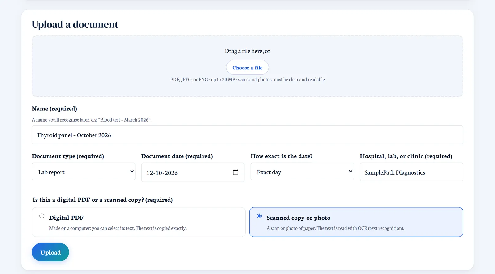
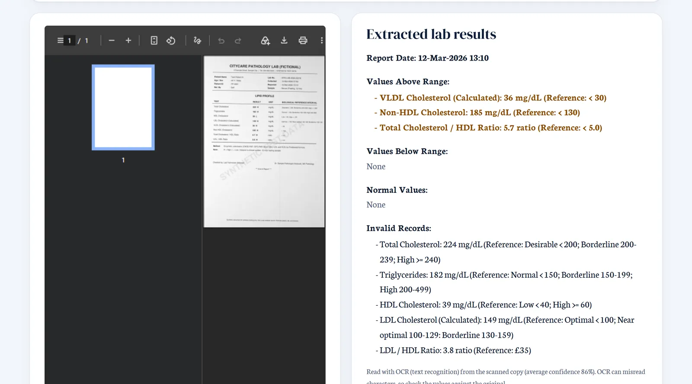
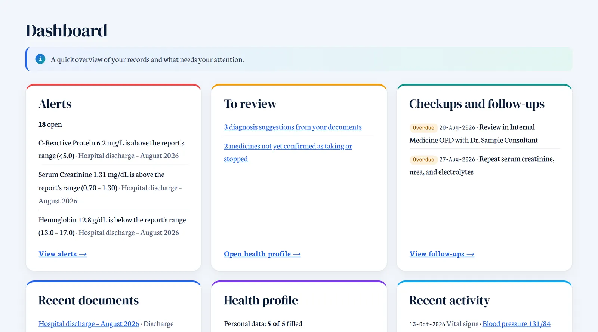
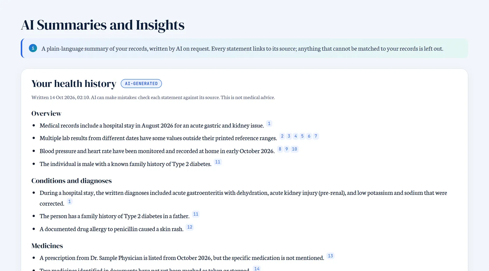

# Healthfolio

**Your medical history, organised and explained.** An AI healthcare support system.

A personal health-records platform that stores medical documents, extracts and organizes their information, tracks medications and follow-ups, and provides cautious, source-backed AI summaries. It offers informational decision support only and does not replace professional medical care.

> **Status:** user accounts, medical document storage, and AI extraction of lab results (with a review screen) are in place. Extraction is not yet validated against an accuracy evaluation and must only be used with synthetic data. The other health-record features are being built step by step against the specifications below.

## Screenshots

Screens from a demo account with fictional sample reports.

| Upload (digital or scanned) | Check what was read |
|---|---|
|  |  |
| **Dashboard** | **AI summary with sources** |
|  |  |

## Tech Stack

| Layer | Technology |
|---|---|
| Backend | Python 3.12, FastAPI, Pydantic, SQLAlchemy 2, Alembic |
| Database | PostgreSQL 16 (Docker Compose for local development) |
| Frontend | React, Vite, TypeScript, React Router |
| Text reading | PyMuPDF (digital-PDF text), Tesseract OCR via pytesseract (scanned copies and photos), Pillow (image clean-up) |
| AI | Qwen3.8-27B on Groq (official Groq SDK): organises the text into structured fields; reads page images only when OCR cannot |
| Exports | fpdf2 (PDF health summary), standard-library CSV, JSON, and ZIP |
| Background jobs | PostgreSQL job queue + worker process |
| Testing | pytest (backend), Vitest + Testing Library (frontend) |
| Tooling | uv (Python), npm, ruff, oxlint |

## Project Structure

```
├── backend/                 FastAPI application
│   ├── app/
│   │   ├── api/v1/          Versioned API routes (/api/v1)
│   │   ├── core/            Config, logging, errors, middleware, security
│   │   ├── db/              Database engine, sessions, ORM base
│   │   ├── models/          SQLAlchemy models
│   │   ├── repositories/    Database access
│   │   ├── schemas/         Request/response models
│   │   └── services/        Business logic (auth, email)
│   ├── alembic/             Database migrations
│   └── tests/               Unit and integration tests
├── frontend/                React + Vite single-page app
│   └── src/
│       ├── api/             Central API client
│       ├── auth/            Session state, route protection
│       ├── components/      App shell and shared components
│       ├── pages/           Page components
│       └── styles/          Design tokens
├── docker/                  Database init scripts
├── docker-compose.yml       Local PostgreSQL
└── spec/                    Product, data model, backend, API, AI, frontend, and observability specifications
```

## Prerequisites

- [Docker Desktop](https://www.docker.com/products/docker-desktop/) (running)
- [uv](https://docs.astral.sh/uv/) — installs Python 3.12 for the backend automatically
- Node.js 20+ and npm
- [Tesseract OCR](https://github.com/tesseract-ocr/tesseract) 5, for scanned copies (on Windows: `winget install --id UB-Mannheim.TesseractOCR`). Without it, scanned pages are read by the AI from their images.

## Setup and Run

### 1. Start the database

```bash
docker compose up -d
```

Creates `healthcare_dev` and `healthcare_test` databases on `localhost:5432`.

### 2. Backend

```bash
cd backend
cp .env.example .env        # local settings; never commit .env
uv sync                     # creates .venv with Python 3.12 and dependencies
uv run uvicorn app.main:app --reload --port 8000
```

- API base: `http://localhost:8000/api/v1`
- Interactive docs (development only): `http://localhost:8000/api/v1/docs`

> If another virtual environment is active in your shell, `uv` warns that `VIRTUAL_ENV` does not match. Run `deactivate` first (or ignore the warning — uv uses `backend/.venv`).

### 3. Frontend

```bash
cd frontend
cp .env.example .env
npm install
npm run dev
```

Open `http://localhost:5173` and create an account. The **System Status** page shows whether the backend and database are reachable.

### 4. AI extraction worker (optional)

Extraction is **off by default**, because documents are sent to an external AI provider. Use only synthetic test documents.

1. Add your own Groq key to `backend/.env` (never commit it): `GROQ_API_KEY=...`
2. Set `EXTRACTION_ENABLED=true` in `backend/.env` and restart the backend.
3. In a separate terminal:

```bash
cd backend
uv run python -m app.worker          # keeps running; add --once to process the queue and exit
```

Every upload queues a job. When uploading, you say whether the file is a **digital PDF** or a **scanned copy** (photos are always scanned). The worker gets the text first: digital PDFs with **PyMuPDF**, scanned copies with **Tesseract OCR** (300 DPI, cleaned up, table rows kept together). The AI then organises that text into structured fields. A page OCR cannot read confidently (below 85% average confidence) is sent to the AI as an image instead, so a poor scan is not silently misread. Each document shows how it was read and the OCR confidence, and values with unreadable characters are marked for review. The document page shows a plain-text summary: values above and below the reference range printed in the report, normal values, and invalid records (no range, not a single number, or unclear; shown as written, not judged). Range checks are done by fixed rules in code, never by the AI.

Consultation notes (symptoms, observations, assessment, plan, follow-ups), written imaging reports (findings, impression, and the report's own uncertainty statements; scan images are not read yet), and other test reports such as ECGs (measurements against their printed ranges, machine and physician interpretations kept apart) get their own summaries too, all copied exactly as written.

Uploads are checked before saving: blurry, too dark, blank, or very small photos and scanned pages are sent back with a request for a clearer copy (typed PDFs are always clear). Discharge summaries must be **one page** (the page with the diagnosis and discharge medicines), due to AI reading limits. Values a report does not state are never guessed and are shown as **"Not mentioned"**. Values that are printed but cannot be read reliably (for example an OCR misread) are shown as **"Not identified"**, marked for review, and never compared with a range: the app shows a gap rather than a wrong number. Each value is also checked against the line it was printed on, so a value taken from another row of the table is never shown as the test's result. Dates from a document are shown exactly as printed; a date like 02/09/26, where day and month could be swapped, is never converted.

Discharge summaries show the hospital, the stay (with the number of days), diagnoses exactly as written, key results (last value outside the printed range, with first → last, or text results), discharge medicines, follow-ups, and when to return to the emergency department. AI output can vary from run to run, so every document offers **Refresh analysis** after reading (also after an empty or failed reading). It replaces the results with a new reading, and a PDF can be read again as the other kind of copy (digital or scanned).

The **Health Profile** brings together your body measurements (height, weight, and calculated BMI with its adult category), medical history (conditions, past surgeries, hospitalizations, including stays read from discharge summaries), vital signs as dated readings (blood pressure and heart rate, the latest shown with its date and every reading on the Timeline, never labelled high or low), active medications (prescription, over-the-counter, and supplements), allergies with their type and reaction (shown first), and family medical history, with a history of every change to your details. Diagnoses read from your discharge summaries appear as suggestions that join your profile only when you accept or correct them; nothing is replaced without you.

A public **Welcome page** (`/welcome`, shown at the home address when signed out) introduces what Healthfolio does, how it works, and how to access it, with buttons to log in or create an account. A **See it in action** section walks through each step with screenshots (taken from a demo account with fictional sample reports); a click opens one full size.

The **Dashboard** gives a one-page overview: open and urgent alerts, items to review, overdue and upcoming follow-ups, recent documents and their reading status, profile completeness with allergies, BMI, and the latest vital signs, and recent activity, each linking to its page.

**AI Summaries and Insights** writes a plain-language summary of your whole history, or of one document, only when you ask. The AI works from your already-extracted records, given as numbered facts, and must cite them; code then removes any sentence whose numbers, months, or sources do not match. Each statement links to its source, AI interpretations and general medical information are labelled separately (with a reminder to ask your doctor), gaps such as unconfirmed medicines or overdue follow-ups are found by fixed rules, and the page says when your records changed since the summary. Your name, email, and date of birth are never sent.

**Account and Privacy Settings** shows your account, lets you change your password (other devices are signed out), and exports your data: a readable PDF health summary built by fixed rules, all records as JSON or as CSV files, and a ZIP of your original documents, each prepared on request and never stored on the server. Deleting your account needs your password and the word DELETE; it removes your files and every record at once, keeps only an anonymous security log for 90 days, and explains that backups expire within 30 days.

**Alerts** come from fixed, documented rules, never from AI. The first rule flags a result outside the range printed on its own report, as an item to review with a doctor, not a diagnosis. Each alert explains why it was raised, what to keep in mind, what to do next, and links to its source. Alerts can be acknowledged and resolved, and keep their history. The page always shows emergency guidance and states that having no alerts does not mean you are healthy.

**Search** (on the Timeline page) finds any word across your records (tests, medicines, diagnoses, report text, allergies, history), shows which field matched with the words highlighted, and can be narrowed by document type, hospital, condition, and dates. The search text is never put in the page address or logs.

The **Health Timeline** shows all your records in date order: lab results (one entry per report date, results outside the printed range first), imaging and test reports, consultations, hospital stays, prescriptions, medicines, and follow-ups. Each entry says where it came from and whether you confirmed or changed it, and opens its source. Results from different dates are never combined or compared. It can be filtered by category and date.

The **Medical Documents** list can be filtered by type, report date range, and hospital or clinic, and grouped by type, month, or hospital, with a count per group. The choices are kept in the page address, so refreshing keeps them.

The **Medications** page lists every medicine read from your documents and any you add yourself, grouped as taking now, not confirmed, and stopped. A medicine from a document is never marked as being taken until you confirm it. You can edit details, mark a medicine as taking or stopped, or remove it, and each medicine keeps a full change history. Medicines you changed are kept when a document is read again or deleted.

Prescriptions get their own summary: the date and doctor, each medicine with its instructions and duration, upcoming follow-ups grouped by date (dates written as "after 4 weeks" are calculated by code from the prescription date), with anything unclear marked "(unclear – check original)". "Add to Checkups and Follow-ups" saves the follow-ups to the Checkups and Follow-ups page, where each can be marked done or cancelled. If no document type was chosen at upload, the AI first decides whether it is a lab report or a prescription.

### Database migrations

```bash
cd backend
uv run alembic upgrade head
```

### Password-reset emails in development

With `EMAIL_BACKEND=file`, emails are written to `backend/.dev_mail/` (git-ignored) instead of being sent. Open the newest `.eml` file to find the reset link.

## Configuration

Backend settings come from environment variables (`backend/.env` in development). See `backend/.env.example`.

| Variable | Purpose | Default |
|---|---|---|
| `APP_ENV` | `development`, `test`, or `production` | `development` |
| `DATABASE_URL` | PostgreSQL connection string (required) | — |
| `CORS_ORIGINS` | Comma-separated allowed frontend origins | — |
| `LOG_LEVEL` | `DEBUG`, `INFO`, `WARNING`, `ERROR` (DEBUG refused in production) | `INFO` |
| `MAX_UPLOAD_MB` | Maximum document upload size | `20` |
| `ACCESS_TOKEN_MINUTES` / `REFRESH_TOKEN_DAYS` | Token lifetimes | `15` / `7` |
| `JWT_SECRET` | Signing key for access tokens (required, 32+ characters) | — |
| `COOKIE_SECURE` | Refresh cookie sent over HTTPS only (must be `true` in production) | `true` |
| `FRONTEND_BASE_URL` | Used to build password-reset links | `http://localhost:5173` |
| `LOGIN_MAX_FAILURES` / `LOCKOUT_MINUTES` | Account lockout after repeated failed logins | `5` / `15` |
| `PASSWORD_RESET_MINUTES` | Reset-link lifetime | `30` |
| `EMAIL_BACKEND` / `DEV_MAIL_DIR` | `file` writes emails to a local folder in development; `disabled` sends nothing (password reset unavailable) | `file` / `.dev_mail` |
| `DOCUMENT_STORAGE_DIR` | Where uploaded documents are stored in development (git-ignored) | `storage/documents` |
| `STORAGE_BACKEND` / `S3_BUCKET` | `local` disk, or `s3` with a private, encrypted bucket | `local` / — |
| `UPLOAD_RATE_LIMIT_PER_HOUR` | Uploads allowed per user per hour | `30` |
| `SUMMARY_RATE_LIMIT_PER_HOUR` | AI summaries a user can request per hour | `20` |
| `EXTRACTION_ENABLED` | Turn on AI extraction (external provider; synthetic data only) | `false` |
| `GROQ_API_KEY` | Your Groq API key (secret; never committed) | — |
| `AI_MODEL` | Model used for extraction | `qwen/qwen3.8-27b` |
| `EXTRACTION_MAX_ATTEMPTS` | Retries for temporary AI failures | `3` |
| `TESSERACT_CMD` | Path to `tesseract` when it is not on `PATH` or in `C:\Program Files\Tesseract-OCR` | auto-detected |
| `OCR_MIN_CONFIDENCE` | Scanned pages read with less average OCR confidence go to the AI as images | `85` |

Frontend: `VITE_API_BASE_URL` (public; never put secrets in `VITE_` variables).

## API

| Method | Endpoint | Description |
|---|---|---|
| GET | `/api/v1/health/live` | Liveness: the process is running |
| GET | `/api/v1/health/ready` | Readiness: the database is reachable (`503` if not) |
| POST | `/api/v1/auth/register` | Create an account and log in |
| POST | `/api/v1/auth/login` | Log in (returns an access token; sets an HttpOnly refresh cookie) |
| POST | `/api/v1/auth/refresh` | Renew the access token (rotates the refresh cookie) |
| POST | `/api/v1/auth/logout` | End the session |
| POST | `/api/v1/auth/password/forgot` | Email a password-reset link |
| POST | `/api/v1/auth/password/reset` | Set a new password with a reset token |
| GET | `/api/v1/users/me` | The logged-in user |
| POST | `/api/v1/documents` | Upload a PDF, JPEG, or PNG (multipart; optional type, date, provider) |
| GET | `/api/v1/documents` | List your documents (newest first, paginated; filter by type, report date range, hospital or clinic) |
| GET | `/api/v1/documents/providers` | Your hospital and clinic names, for the filter |
| GET | `/api/v1/timeline` | Your records in date order (filter by category and date) |
| GET | `/api/v1/alerts` | Your safety alerts |
| PATCH | `/api/v1/alerts/{id}` | Acknowledge or resolve an alert |
| GET | `/api/v1/profile` | Your health profile and suggestions |
| PATCH | `/api/v1/profile/values` | Update personal details |
| GET, POST | `/api/v1/vitals` | Your blood pressure and heart rate readings; add one |
| GET | `/api/v1/dashboard` | One-page overview for the dashboard |
| POST | `/api/v1/search` | Search your records (query in the body, never in the URL) |
| GET, POST | `/api/v1/summaries/history` | Read or write the AI summary of your whole history |
| GET, POST | `/api/v1/documents/{id}/summary` | Read or write the AI summary of one document |
| GET | `/api/v1/account/export/{pdf,json,csv,documents}` | Download your data |
| POST | `/api/v1/auth/password/change` | Change your password |
| POST | `/api/v1/auth/account/delete` | Delete your account and all its data |
| POST | `/api/v1/profile/suggestions/{id}` | Accept, correct, or reject a suggested diagnosis |
| GET | `/api/v1/documents/{id}` | Document details |
| GET | `/api/v1/documents/{id}/file` | The original file (inline, or `?download=true`) |
| PATCH | `/api/v1/documents/{id}` | Edit type, date, or provider |
| DELETE | `/api/v1/documents/{id}` | Delete the document, its file, and its extracted results |
| GET | `/api/v1/documents/{id}/observations` | Extraction status and extracted lab results |
| POST | `/api/v1/documents/{id}/extract` | Queue extraction (first time, or retry after a failure) |
| POST | `/api/v1/documents/{id}/follow-ups` | Add a prescription's follow-ups to Checkups and Follow-ups |
| GET | `/api/v1/follow-ups` | List follow-ups (overdue computed) |
| PATCH | `/api/v1/follow-ups/{id}` | Mark a follow-up done, cancelled, or scheduled again |
| GET, POST | `/api/v1/medications` | List medicines; add one |
| PATCH, DELETE | `/api/v1/medications/{id}` | Edit or change status; remove (history kept) |
| GET | `/api/v1/medications/{id}/history` | A medicine's change history |

Full request/response details: `spec/api_contract_spec.md` Sections 5.1, 6.1, and 6.2.

### Security highlights

- Passwords hashed with Argon2id; refresh and reset tokens stored only as hashes.
- Short-lived access token kept in browser memory; refresh token in a `Secure`, `HttpOnly`, `SameSite=Strict` cookie, rotated on every use with theft detection.
- Generic login errors, account lockout, and per-IP rate limits.
- Audit events for security-relevant actions, without passwords, tokens, or medical content.
- AI extraction: the document is passed as data, never as instructions; output must match a strict schema and is re-validated by deterministic checks; uncertain values are flagged for review; logs record IDs, timings, and token counts only.
- Uploaded files are identified by their content (not their name), size-limited before the upload is read, stored under opaque IDs, and only reachable through the authenticated API. Every document query is scoped to its owner.

All errors use one format:

```json
{ "error": { "code": "NOT_FOUND", "message": "...", "details": [], "request_id": "..." } }
```

Every response carries an `X-Request-ID` header for troubleshooting.

## Testing

```bash
# Backend (integration tests need the database running)
cd backend
uv run ruff check .
uv run pytest                    # all tests
uv run pytest -m "not integration"   # without the database
RUN_LIVE_AI=1 uv run pytest -m live # one real AI call on a synthetic report (costs a little)

# Frontend
cd frontend
npm run lint
npm run test
npm run build
```

### Accuracy evaluation

Fictional reports with known answers are generated, saved as digital PDFs and as scans at three damage levels, read by the real pipeline, and scored (items found, field accuracy, invented items, review flags, OCR error rate, consistency). It calls the AI provider, so it is run on demand, not in the test suite.

```bash
cd backend
uv run python -m evaluation generate        # 60 test documents (no AI calls)
uv run python -m evaluation run --quick     # 10 documents; omit --quick for all, add --repeat 3 for consistency
uv run python -m evaluation report          # HTML report
```

## Deployment

Healthfolio runs on AWS (region `ap-south-1`). The infrastructure is defined with Terraform in `infra/`:

- **Server:** one small EC2 server with a fixed IP. Caddy serves the website, handles HTTPS (free Let's Encrypt certificate, renewed automatically) and forwards `/api/*` to the app, so the site and API share one address. The address is `https://<ip>.sslip.io`, which needs no domain.
- **API and worker:** one Docker image (`backend/Dockerfile`, includes Tesseract), stored in Amazon ECR. Database migrations run on start.
- **Database:** Amazon RDS for PostgreSQL, private, reachable only from the server. Its password is kept in AWS Secrets Manager.
- **Files:** uploaded documents go to a private, encrypted S3 bucket (`STORAGE_BACKEND=s3`), accessed through the server's IAM role (no access keys). The built website is also kept in S3.

No email service is configured (`EMAIL_BACKEND=disabled`), so password reset is unavailable on the deployed app. See `infra/README.md` for the deployment steps.

## Specifications

The system is defined by these specs: `goal_spec.md` (product scope), `backend_spec.md`, `api_contract_spec.md`, `data_model_spec.md`, `AI_spec.md`, `frontend_spec.md`, and `observability_and_reliability_spec.md`.

## Future Improvements

An accuracy evaluation set for AI extraction and summaries, reminder delivery, Unicode fonts in the PDF export, trends across dates, and Health Q&A — delivered incrementally as their data model and API contracts are defined.

## License notes

PyMuPDF is licensed under AGPL-3.0: suitable for this open project; a closed-source commercial deployment would need its commercial licence or a permissive alternative (for example pypdf). Tesseract OCR is Apache-2.0.
