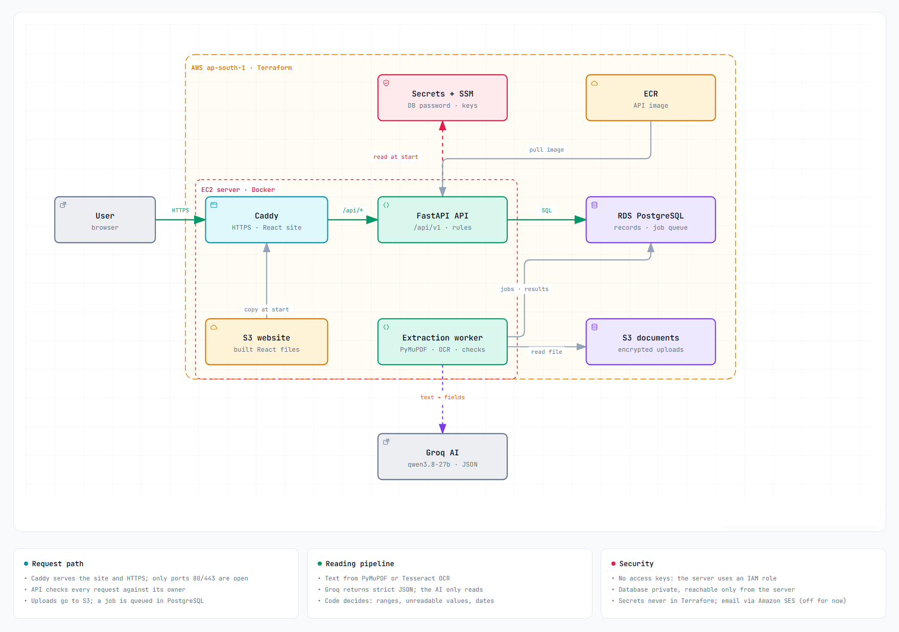
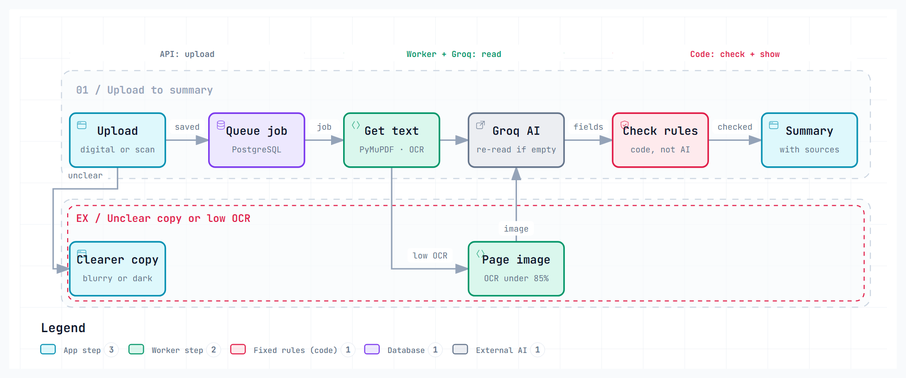
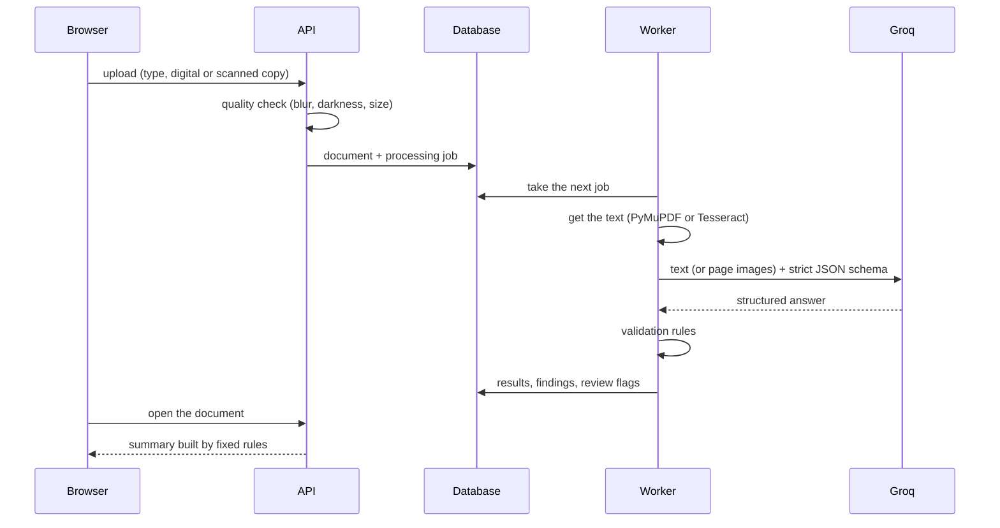

# Healthfolio: End-to-End Guide

From the implementation, through testing and AI evaluation, to deployment on AWS. Feature descriptions are in the main [README](../README.md). The decided behaviour is in [`spec/`](../spec). Exact deployment commands are in [`infra/README.md`](../infra/README.md).

> [!IMPORTANT]
> **AI accuracy has not been rigorously validated.** The built-in evaluation uses fictional reports only; it is not clinical validation, and the target of 98% accuracy on critical fields is not met yet. Rigorous validation, on a de-identified real-document set with repeated runs, is planned for the future. Use synthetic documents only, and always check results against the original document.

- [1. Architecture](#1-architecture)
- [2. Local setup](#2-local-setup)
- [3. How a document is read](#3-how-a-document-is-read)
- [4. What the AI may and may not decide](#4-what-the-ai-may-and-may-not-decide)
- [5. Testing](#5-testing)
- [6. AI evaluation](#6-ai-evaluation)
- [7. Deployment on AWS](#7-deployment-on-aws)
- [8. Operating the live app](#8-operating-the-live-app)
- [9. Known limitations](#9-known-limitations)

---

## 1. Architecture





*Made with [Archify](https://github.com/tt-a1i/archify). The interactive version is [`architecture/healthfolio-architecture.html`](architecture/healthfolio-architecture.html) (download and open it in a browser). Source: [`healthfolio-architecture.json`](architecture/healthfolio-architecture.json).*

| Layer | Technology | Where |
|---|---|---|
| Frontend | React, Vite, TypeScript | `frontend/src` (feature folders: documents, timeline, profile, …) |
| API | FastAPI, Pydantic, SQLAlchemy 2, Alembic | `backend/app/api/v1` → `services` → `repositories` / `models` |
| Worker | Python process polling `processing_jobs` | `backend/app/worker.py`, `services/extraction_service.py` |
| AI reading | PyMuPDF, Tesseract OCR, Groq (strict JSON schema) | `backend/app/ai/` |
| Database | PostgreSQL 16 | Docker locally, Amazon RDS when deployed |
| Files | Local disk or a private S3 bucket | `services/storage.py` |
| Email | File (development), Amazon SES, or disabled | `services/email.py` |
| Infrastructure | Terraform | `infra/` |

---

## 2. Local setup

**Prerequisites:**
- Docker Desktop
- [uv](https://docs.astral.sh/uv/) (it installs Python 3.12)
- Node.js 20+
- Tesseract OCR 5, for scanned copies

**Database** (creates `healthcare_dev` and `healthcare_test`):

```bash
docker compose up -d
```

**Backend:**

```bash
cd backend
cp .env.example .env            # add GROQ_API_KEY yourself; set EXTRACTION_ENABLED=true
uv sync
uv run alembic upgrade head
uv run uvicorn app.main:app --reload --port 8000
```

**Extraction worker** (in a second terminal):

```bash
cd backend
uv run python -m app.worker
```

**Frontend:**

```bash
cd frontend
cp .env.example .env
npm install
npm run dev                     # http://localhost:5173
```

All settings are listed in the README's [Configuration](../README.md#configuration) section and in `backend/.env.example`.

---

## 3. How a document is read



1. **Upload.** The user picks the document type and says whether it is a digital PDF or a scanned copy. Photos and scans are checked for blur, darkness, blank pages, and size; unclear copies are sent back. A job is queued.
2. **Getting the text** (`ai/reading.py`):
   - Digital PDFs: PyMuPDF reads the text layer.
   - Scans: Tesseract OCR at 300 DPI, after cleanup, with table rows kept together.
   - A page below 85% average OCR confidence is sent to the AI as an image instead.
   - Each reading records how it was read and its OCR confidence.
3. **Structuring** (`ai/extractor.py`):
   - Groq returns JSON that must match a strict schema for that document type: lab report, prescription, discharge summary, consultation note, imaging report, or other test report.
   - The model copies values exactly as written and lists anything it cannot read.
   - If it answers with nothing for a page that clearly has text, the request is sent up to two more times. After that, the reading fails with a clear message instead of "no results".
4. **Validation** (fixed code, below). Each result is stored with its findings and a "needs review" flag.
5. **Summaries** are built by rules from the stored rows:
   - lab results: above, below, or within the range printed on the report, or invalid;
   - prescriptions: medicines and follow-ups;
   - discharge summaries: the stay, key results, and medicines;
   - consultation notes, imaging reports, and other test reports.

   **Alerts** use the same range rule. **AI summaries** of a whole history work only from already-extracted records, given as numbered facts. Code removes any sentence whose numbers, months, or sources do not match.
6. **Refresh analysis.** Any document can be read again, also switching a PDF between the digital and scanned routes.

---

## 4. What the AI may and may not decide

The AI only reads. Everything that could mislead is decided by deterministic code:

| Rule | Code | Effect |
|---|---|---|
| Not mentioned vs Not identified | `ai/readability.py` | Not printed → "Not mentioned". Printed but unreadable → "Not identified": never guessed, never compared with a range. |
| Value on its own line | `ai/source_check.py` | A value found only on another test's line (swapped rows) becomes Not identified. A value on no line is flagged and not compared. Results from page images are never compared. |
| Dates as printed | `ai/dates.py` | Dates are shown exactly as printed. "02/09/26" (day and month could be swapped) keeps no calendar date, and no follow-up date is calculated from it. |
| Range check | `services/lab_summary.py` | Only the range printed next to the test is used, applied exactly ("< 5.0", "a – b"). A value more than 10× outside a two-sided range is marked "check the original". |
| Follow-up dates | `ai/prescription_validation.py` | "After 4 weeks" is calculated by code from the printed date and labelled "calculated". |
| Medicines | `ai/prescription_validation.py` | A medicine read from a document is never marked as being taken until the user confirms it. |

---

## 5. Testing

| Suite | Size | Command |
|---|---|---|
| Backend: unit and integration (fake Groq client, real PostgreSQL test database) | 546 tests | `cd backend && uv run pytest` |
| Backend without the database | 318 tests | `uv run pytest -m "not integration"` |
| One real AI call on a synthetic report (costs a little) | 3 tests | `RUN_LIVE_AI=1 uv run pytest -m live` |
| Frontend: components and pages (Vitest, Testing Library) | 138 tests in 17 files | `cd frontend && npm run test` |
| Lint and types | — | `uv run ruff check .`, `npm run lint` (oxlint), `npm run build` (`tsc -b` + Vite) |

The backend tests use a scripted fake Groq client (`tests/ai_fakes.py`). Because every value is checked against its line in the document, each test PDF prints exactly what the fake AI returns (`printed_lines(...)`).

---

## 6. AI evaluation

> [!IMPORTANT]
> **AI accuracy has not been rigorously validated.** The built-in evaluation uses fictional reports only; it is not clinical validation, and the target of 98% accuracy on critical fields is not met yet. Rigorous validation, on a de-identified real-document set with repeated runs, is planned for the future. Use synthetic documents only, and always check results against the original document.

### Method

`backend/evaluation/` measures the real pipeline without real patient data:

1. **Fictional cases with known answers.** 15 seeded cases: lab reports, prescriptions, discharge summaries, consultation notes, and imaging reports. The cases include missing units, missing ranges, "<" values, and two-page reports.
2. **Each case is rendered four ways:**
   - as a digital PDF;
   - as scans at three damage levels: clean, medium, and hard (blur, noise, rotation, low contrast).

   That gives 60 documents.
3. **Real pipeline.** Each document goes through the upload check, PyMuPDF or Tesseract (with the vision fallback), Groq, and the validation rules. The answers are cached, and runs can be resumed.
4. **Scoring** against the known answers:

| Measure | Meaning |
|---|---|
| Items found | Expected results, medicines, and follow-ups that were read |
| Fields right | Value, unit, and range exactly right |
| Misleading fields | Wrong, and shown as if it were the value (the worst outcome) |
| Not identified | Printed but shown as "Not identified": an honest gap |
| Misleading groups | Shown as above, below, or normal, but in the wrong group |
| Wrong items flagged | Wrong values that were marked for review |
| Dates right / dates as printed | The calendar date (or none, when ambiguous) / the printed form shown unchanged |
| Honest blanks | Fields not printed that were left empty instead of guessed |
| OCR CER | Character error rate of the OCR text |

```bash
cd backend
uv run python -m evaluation generate                    # 60 documents, no AI calls
uv run python -m evaluation run --quick --tag <name>    # 10 documents (all types, all scan levels)
uv run python -m evaluation run --tag <name>            # all 60; add --repeat 3 for consistency
uv run python -m evaluation report --tag <name> --baseline <older-name>   # HTML report with a comparison
```

### Results (quick set: 10 documents, single runs)

The quick set has 106 expected items and covers lab reports (digital, clean, medium, and hard scans), a prescription (digital and medium scan), a discharge summary, and an imaging report.

| Measure | First version | With "Not identified" rules | With row check and dates as printed |
|---|---|---|---|
| Misleading fields | 35 / 279 | 5 / 279 | 10 / 258 (6 flagged for review) |
| Misleading groups | 0 | 2 | **0** |
| Fields right | 87.5% | 96.4% | 91.1% |
| Grouping right | 65.8% | 89.5% | 68.1% |
| Wrong values flagged for review | 20 / 21 | 0 / 5 | 6 / 10 |
| Dates right | 16 / 16 | 14 / 16 | **16 / 16** |
| Dates shown as printed | — | — | **10 / 10** |
| Items found | 106 / 106 | 106 / 106 | 99 / 106 |
| Invented items | 1 | 0 | 0 |

**Reading the latest column:**
- **Misleading groups stayed at 0:** no result was presented as above, below, or normal in the wrong group.
- **Grouping right fell by design.** Results read from page images (the hard scan) are no longer compared at all.
- **One medium scan was read less completely.** On the same OCR text, the AI returned 5 of 12 results in that run, compared with 12 in the previous run. That was run-to-run variation, not the new rules.
- **Wrong values flagged for review** rose from 0 of 5 to 6 of 10. The first version flagged almost all of its wrong values, but because it rated every OCR value low-confidence, correct values were flagged too.

### Against the release thresholds

The release thresholds are in `spec/AI_spec.md` §11:

| Gate | Threshold | Status |
|---|---|---|
| Critical fields | ≥ 98% field accuracy | **Not met** (91–96%) |
| Low-confidence critical fields routed to review | All | Met for unreadable and off-line values; OCR misreads copied faithfully still pass |
| Non-critical fields | ≥ 90% | Not measured separately yet |

**AI accuracy has not been rigorously validated.** The evaluation shows behaviour and failure points on fictional documents; it is not clinical validation. Rigorous validation (a de-identified real-document set, repeated runs, and meeting the 98% critical-field gate) is kept as a future plan. Until then, use synthetic documents only.

---

## 7. Deployment on AWS

The architecture diagram in [section 1](#1-architecture) shows the deployed setup.

Region: `ap-south-1`. Everything is defined with Terraform in `infra/`. State is kept in a private, versioned S3 bucket.

| Resource | Purpose |
|---|---|
| EC2 (`t3.small`) with an Elastic IP | Runs Caddy and the app container under systemd (`infra/server-setup.sh`). Only ports 80 and 443 are open. There is no SSH; Session Manager is used instead. |
| ECR `healthfolio-api` | The API image (`backend/Dockerfile`, includes Tesseract). It keeps the last 5 images. |
| RDS PostgreSQL 16 (`db.t4g.micro`) | Private, encrypted, with deletion protection. It accepts connections only from the server. |
| S3: documents and website | Private and encrypted. The server reaches them through its IAM role; there are no access keys. |
| Secrets Manager / SSM Parameter Store | The DB password (generated by AWS); the Groq key and JWT secret (entered by the owner); non-secret settings. |
| SES | Password-reset email. Switched off until SES production access is granted. |
| AWS Budgets | Email alerts at 80% (forecast) and 100% of the monthly limit. |

**No secret is in Terraform, its state, the image, or this repository.** The server reads the secrets each time it starts.

**Steps.** Full commands are in [`infra/README.md`](../infra/README.md).
1. Store `/healthfolio/groq_api_key` and `/healthfolio/jwt_secret` as SecureString parameters.
2. Run `terraform plan`, then `terraform apply` in `infra/`.
3. Build the image and push it to ECR.
4. Build the website with `VITE_API_BASE_URL=/api/v1`, sync it to the website bucket, and restart the web service.
5. Check `https://<ip>.sslip.io/api/v1/health/ready`. It returns `{"status":"ready","checks":{"database":"ok"}}`.

On start, the server:
1. installs Docker;
2. reads the settings;
3. pulls the image;
4. starts the app (migrations run first in the container);
5. starts Caddy, which gets and renews the HTTPS certificate.

**Why this design:** this AWS account cannot yet use CloudFront (it needs account verification), Lightsail containers, or CodeBuild (quota 0). So one server handles HTTPS itself. Once the account is verified, CloudFront can be put in front, and the server can stop accepting traffic from the internet.

---

## 8. Operating the live app

| Task | How |
|---|---|
| Release a new API version | Push the image to ECR, then `aws ssm send-command … systemctl restart healthfolio` (pulls `latest`, runs migrations) |
| Release a new website | Build, `aws s3 sync dist s3://<site_bucket> --delete`, then restart `healthfolio-web` |
| Change a secret or setting | Update the SSM parameter, then restart `healthfolio` |
| Logs | Session Manager → `journalctl -u healthfolio -f` (app) or `-u healthfolio-web` (Caddy) |
| Health | `/api/v1/health/live` (process), `/api/v1/health/ready` (database) |
| Roll back the API | Re-tag an earlier image in ECR as `latest`, then restart |
| Turn password reset on | Set `email_backend = "ses"` in `terraform.tfvars`, apply, then restart (after SES production access) |
| Costs | Budget alerts. The main costs are EC2 (~$15/month), RDS (~$15/month), the Elastic IP (~$3.60/month), and Secrets Manager (~$0.40/month). The free tier covers EC2 and RDS on eligible accounts. |

Changing `infra/server-setup.sh` replaces the server on apply. The site is down for about 5 minutes, and a new HTTPS certificate is issued. Let's Encrypt limits repeats to a few a week.

---

## 9. Known limitations

- **AI accuracy is not rigorously validated.** It is below the release gate on the synthetic set, and rigorous validation on de-identified real documents is planned for the future. AI output also varies between runs ("Refresh analysis" re-reads a document). Planned: page-by-page reading with a coverage check that re-reads missed lines.
- **Uploaded document text goes to Groq.** Use synthetic documents only until a privacy review.
- **Password reset is off** until SES production access is granted. In the SES sandbox, mail reaches only verified addresses.
- **The server is reachable from the internet** on ports 80 and 443. CloudFront would remove that once the account is verified.
- **Scan images are not interpreted.** Only written reports are read.
